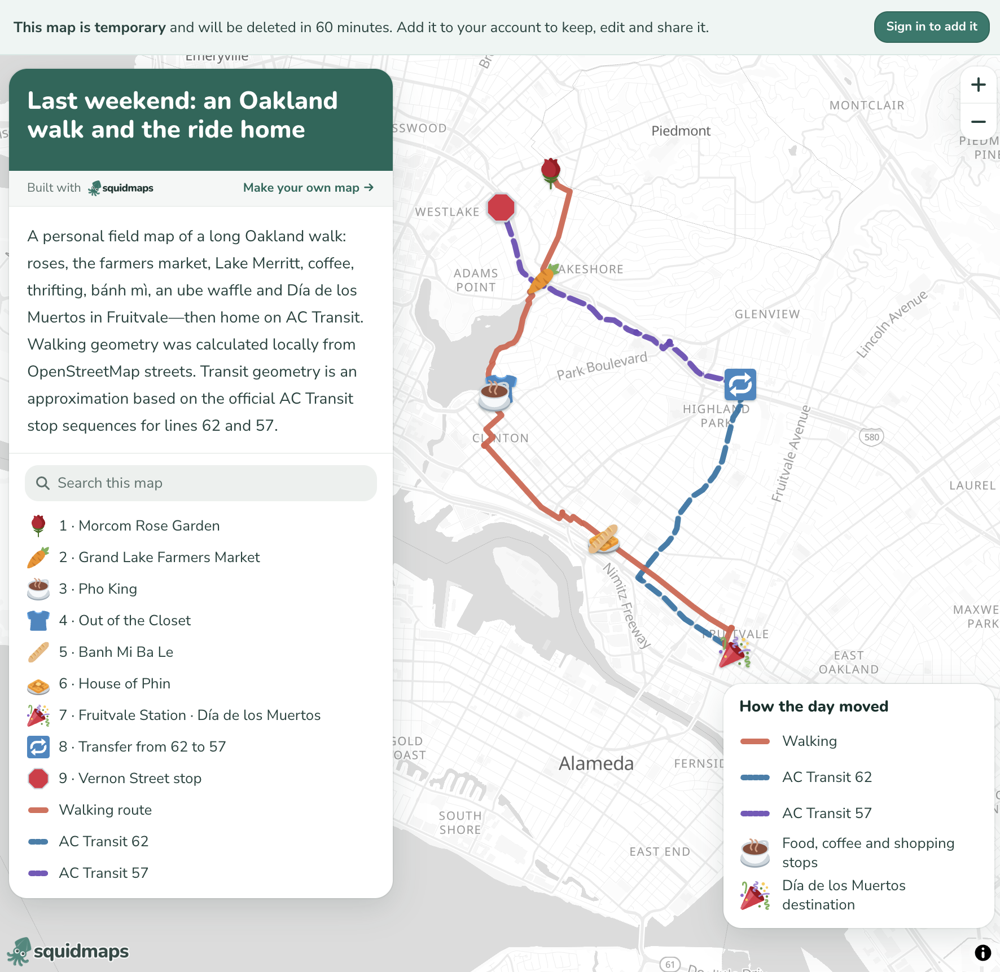
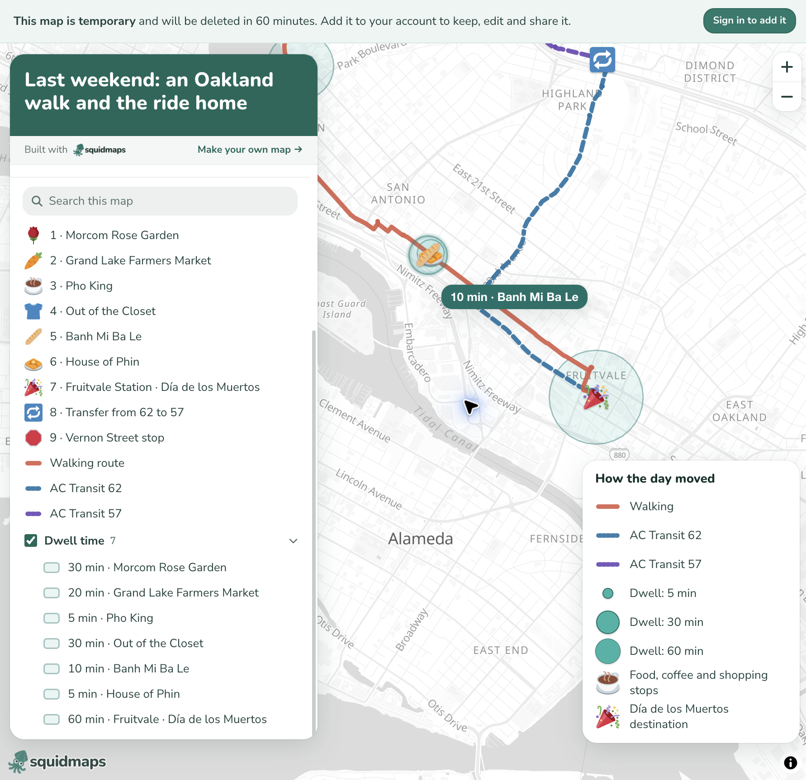

# Talking a Map Into Existence with Squidmaps

The online geo world is relatively small, and [Chris Whong](https://chriswhong.com/) has long been one of the people making interesting things in it. He recently wrapped up a couple years at Mapbox and, shortly afterward, launched the public beta of [squidmaps](https://squidmaps.io/).

When I first saw it, I was reminded of Felt in its early days; not because the products are the same, but because both make web mapping feel unusually lightweight and approachable. Felt has since moved toward the more sophisticated features and larger customers needed to sustain a growing company, leaving “small-time” mapmakers with few good options. Google My Maps exists, but has always felt clunky. The hard part for any alternative is paying for a service aimed at people who may make only an occasional simple map. AI changes that equation: a natural-language interface can support many basic mapping needs without a sprawling product surface, creating room for a low- or no-cost tool that still produces polished maps with guardrails for legibility.

So, back to squidmaps: What really caught my attention was the [ephemeral maps API](https://squidmaps.io/docs/api/ephemeral-maps). An agent can send squidmaps a complete map document without an account or API key and receive a temporary URL in return. It can then replace the map as the conversation continues. Once the map is useful, a person can claim it and keep it.

That creates a very natural conversational mapping loop: describe a map, look at it, ask for a change, and repeat.

## Converting a narrated walk

I tried this workflow I described in the last section, with a walk I took through Oakland. I described the day more or less as I remembered it: start at the Morcom Rose Garden, walk down Grand Avenue to the farmers market, continue along Lake Merritt for coffee and thrifting, head east for bánh mì and an ube waffle, finish at the Día de los Muertos festival in Fruitvale, and then take the 62 and 57 buses home.

From that description, the chatbot resolved the stops, calculated street-following geometry from OpenStreetMap data, assembled the features and styles, and sent the resulting map document to squidmaps. I did not draw or style anything manually.

*The first result from the verbal description: a walking route, two transit legs, labeled stops, and a coherent legend.*

The result was already quite good. The route was readable, the walking and transit legs were distinct, the stops had a consistent visual language, and the map came back as a real artifact I could inspect and share—not merely some code that I still needed to turn into a map.

I eventually saved it as a permanent map: [Last weekend: an Oakland walk and the ride home](https://squidmaps.io/kuanbutts/last-weekend-an-oakland-walk-and-the-ride-home).

## Geo operations do not all need to live in the mapping product

Next, I wanted to show how long I stayed at each stop. I supplied the dwell times and asked for transparent circles whose areas were proportional to the time spent, plus labels on hover.

This is where the architecture became particularly interesting to me. A mapping platform does not necessarily need to implement every standard spatial operation itself. If the destination accepts GeoJSON, an agent can write a small Python script and use something like Shapely to calculate a buffer, union geometries, clip a layer, or generate another derived feature. It can then send the result back as ordinary GeoJSON.

For this map, the chatbot calculated the circle sizes and added the resulting dwell-time features to the existing map document. The same pattern would work for more general geoprocessing outside squidmaps.

*The second iteration added proportional dwell-time circles, a feature group, a size legend, and hover labels.*

This division of labor feels useful. The agent's working environment can handle common geometry operations, while squidmaps handles presentation, interaction, and publishing. There does not need to be a dedicated button in the product for every operation that already exists in mature spatial libraries. This is where squidmaps finally breaks free of the endless feature requirements problem with geo projects (and the ensuring over-technical-ness of them that ultimately alienates the very users who it might have set out to help).

## Constraints are part of the value

AI systems are increasingly capable of writing valid GeoJSON and spatial-processing code. They are still inconsistent at the graphical part of mapping. They choose too many colors, create noisy labels, obscure important features, or produce legends that do not quite explain the map. Humans struggle with these things too, to be fair.

Squidmaps provides a strong set of visual constraints: sensible defaults, a cohesive symbol language, a predictable information panel, legends, folders, tooltips, and a basemap that stays out of the way. Those constraints guide the agent's intent toward something legible.

That is the part that reminds me most of early Felt. The interesting thing is not merely that a nontechnical user can make a map quickly. It is that they can make one by describing what they mean, while the platform keeps the graphical result within a reasonably good cartographic system.

## One possible next step: extrusion

Out of curiosity, I also tried adding elevation to the route so the line could rise and fall with the terrain. The current API does not render altitude-bearing coordinates or line-extrusion properties, and its saved view does not yet accept pitch or bearing. Extra elevation data can travel with a feature, but it remains a flat line.

Extrusion is often overused and can make maps less legible, but this was a case where it would have been useful: the height of the route could have made the long downhill portion of the walk immediately visible. Since the viewer already permits interactive tilting, feature extrusion feels like a natural future addition to the map specification and API.

The experiment left me excited about the underlying pattern. The chatbot translates informal language into structured spatial data and can perform established geo operations in code. Squidmaps supplies the constrained visual system and produces a clean, interactive, shareable map. That seems like a very promising way to make simple mapping genuinely accessible without asking the mapping platform itself to do everything.
