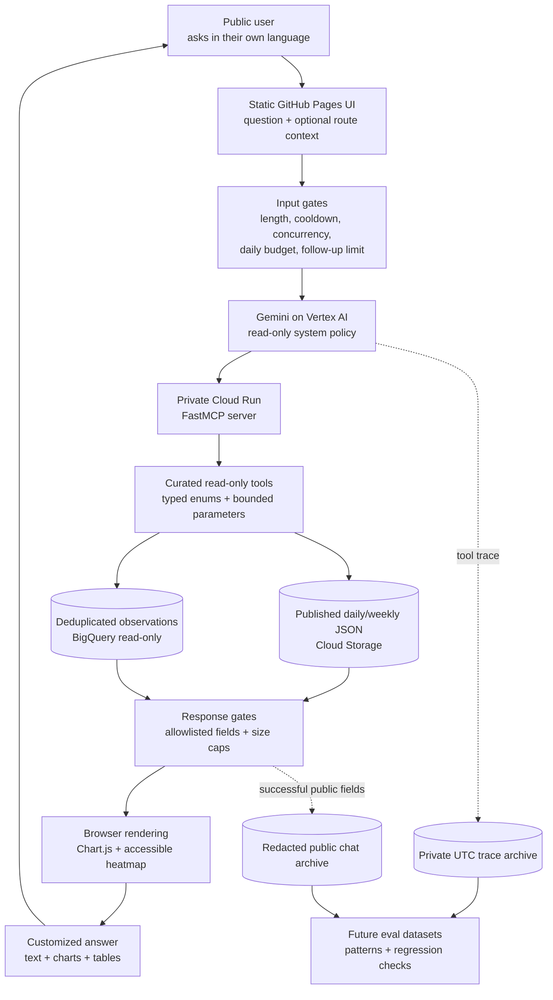
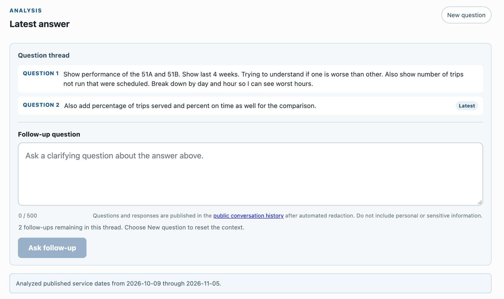
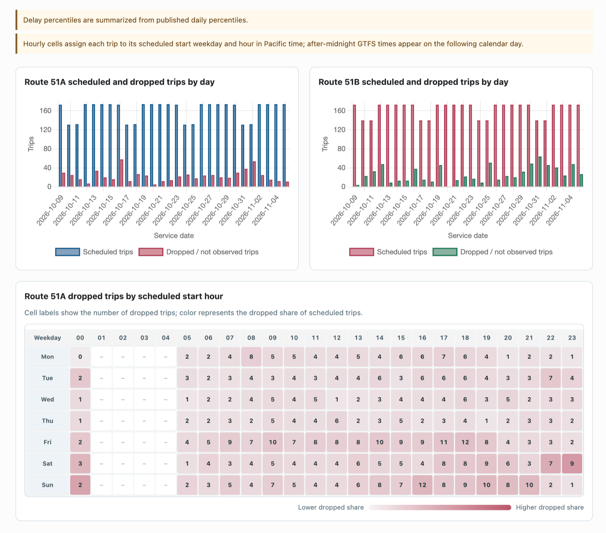

*Generating highly customized chat workflows with tightly curated data models.*

I just returned from the OutpostAI conference, where I noticed a pattern across several talks: there is more data than ever, but the path from a person's question to a useful answer still depends heavily on one person who knows the warehouse, the metric definitions, and how to turn the results into something people can use, usually a dashboard.

One presenter described a hardware company where many people wanted to understand simulation results, but only one person knew the data warehouse well enough to write the queries and generate dashboards. That person had effectively become the interface to the data. Each new question became a ticket, and each new dashboard added to the maintenance burden.

This discussion also made me think about friction I have encountered while presenting AC Transit performance statistics in the [report card project](https://ac-transit.com/report-card/). People want to know where the problems are in a route or the system, but they may not know the terminology needed to find the right metric. They may say that a bus route feels unreliable without knowing whether to look at trip delivery, a rider-window measure, median delay, long gaps, or dropped trips. Making them navigate a dashboard assumes they already understand the data model well enough to choose the correct chart.

I wanted to try a different interface against my [independent AC Transit performance project](https://ac-transit.com/ask/): let somebody ask the question to the extent they understand it, translate that question into a tightly bounded analytical operation, and return the text and graphics that fit the question.

The resulting prototype is not an agent with open access to a database. Instead, it is a small public chat service built around an explicit read-only tool boundary.

## The FastMCP idea that unlocked the prototype

The conference session that helped me shape this idea was about [FastMCP](https://gofastmcp.com/). The basic demonstration was simple: put a decorator on a normal Python function and it becomes a discoverable MCP tool.

The analogy I wrote down was Flask's `@app.route`. The function already exists, but the decorator makes it part of a public interface without requiring me to hand-write all of the protocol plumbing.

More importantly, the decorator is opt-in. An agent does not get "the repository" or "the database." It gets a small list of functions that I deliberately exposed. FastMCP derives a schema from the function signature, uses the docstring as tool guidance, validates arguments, and serializes the result back through MCP.

Here is a shortened version of one of the tools in the project:

```python
from typing import Literal
from fastmcp import FastMCP

mcp = FastMCP("AC Transit performance data")

@mcp.tool
def rank_routes(
    metric: Literal[
        "on_time_service_delivered",
        "trip_delivery",
        "median_delay",
        "dropped_trips",
        "long_gaps",
    ],
    start_date: str | None = None,
    end_date: str | None = None,
    order: Literal["worst", "best"] = "worst",
    limit: int = 10,
    route_group: Literal[
        "regular", "school", "all_nighter", "transbay"
    ] = "regular",
) -> dict:
    """Rank at most ten routes within one service group."""
    return data.rank_routes(
        metric, start_date, end_date, order, limit, route_group
    )
```

Those `Literal` types are doing real product work. The model cannot invent a metric or accidentally mix regular local service with school, All Nighter, or Transbay routes. Those service types should be analyzed separately, but a visitor may not know that the distinction matters. A request outside the enum is rejected before it reaches the query code.

I currently expose only a handful of tools: route and system summaries, same-group route comparisons, route rankings, hourly profiles, a bounded scheduled-arrival list, and public metric definitions. Undecorated helpers and raw query methods stay invisible.

## The workflow

I kept the architecture entirely in GCP except for the static site. The page is hosted on GitHub Pages, the analysis service and MCP run on Cloud Run, the model is accessed through Vertex AI, and the tools read published JSON summaries from Cloud Storage or bounded data from BigQuery.

This makes the prototype a tool-driven form of [retrieval-augmented generation (RAG)](https://en.wikipedia.org/wiki/Retrieval-augmented_generation), although it is not the usual document-and-vector-database version. RAG supplements a language model's trained knowledge with information retrieved from an external source when it answers a question.

Here, the retrieval step is a bounded MCP tool call rather than a semantic search over document chunks. The tools query published JSON summaries or BigQuery, Gemini uses the returned data to write a short answer, and the same tool results supply the charts and tables. The model therefore generates from current AC Transit data instead of relying only on facts stored in its weights.

The important parts of the architecture are the two sets of gates: one before the model sees a request, and another before a response reaches the browser.



The FastMCP service is private to the analysis agent. The public browser never calls it directly and never receives database credentials. The model can only select among the tools the MCP advertises, and the MCP service account has read-only access to the relevant data.



*The public interface makes the cost controls visible and keeps follow-up questions attached to the latest answer.*

## Input hardening is the first half of the lifecycle

Because this is a public service, I assume people will eventually send requests that are irrelevant, adversarial, or simply much larger than I intended. I also want a brief burst of attention to remain cheap.

The current request gates are intentionally aggressive because this is still a prototype:

- 500 characters per prompt
- one request every 20 seconds per browser
- two concurrent queries across the service
- ten questions per browser per day
- a shared daily question budget
- no more than three follow-ups in a thread
- no more than four tool calls and two tool rounds per answer
- at most 31 calendar days for the heavier analytical tools, with plans to extend this window
- at most four hours and 250 rows for a scheduled-arrival listing

These are configuration values, not magic numbers. They can change as I observe real use. The point is that cost and abuse controls are part of the interface, not an invisible emergency measure. The page tells a visitor why they are waiting and how much shared capacity remains.

Prompt rules are useful, but I do not treat them as a reliable security boundary. The harder boundary is that every callable function is read-only, bounded, and typed. There is no general SQL tool and no write tool, which sharply limits the available abuse paths. Row and date limits also block bulk extraction; there is no way to ask for an unbounded table dump.

## Constraining the response is just as important

I also do not want the agent to return arbitrary HTML, JavaScript, images, or a giant JSON blob. The server normalizes every successful result into a small response protocol:

```python
def tool_result(
    answer_context,
    timeframe,
    charts,
    tables,
    sources,
    warnings,
):
    return {
        "answer_context": answer_context,
        "timeframe": timeframe,
        "charts": charts[:3],
        "tables": [
            {**table, "rows": table.get("rows", [])[:250]}
            for table in tables[:2]
        ],
        "sources": sources[:8],
        "warnings": warnings[:8],
    }
```

The final response permits text plus a few structured building blocks:

- up to three charts
- up to two tables with 250 rows each
- up to five series per standard chart
- up to 500 chart points across the answer
- 24 by 7 cells for an hourly heatmap
- eight source records and eight warnings
- a total serialized response cap

The chart vocabulary is deliberately tiny: `bar`, `line`, and `heatmap`. Adding a format is a conscious frontend and backend change rather than something the model improvises.

A simplified response looks like this:

```json
{
  "answer": "Route 1T had 221 scheduled trips...",
  "timeframes": [{
    "start_date": "2026-11-03",
    "end_date": "2026-11-03",
    "assumed": false,
    "disclosure": "Analyzed published service dates..."
  }],
  "charts": [{
    "type": "bar",
    "title": "Route 1T scheduled and dropped trips by day",
    "labels": ["2026-11-03"],
    "series": [
      {"name": "Scheduled trips", "values": [221]},
      {"name": "Dropped / not observed trips", "values": [19]}
    ]
  }],
  "tables": [],
  "warnings": [],
  "sources": [{"kind": "daily_stats"}]
}
```

The model writes only the short narrative. It does not write chart JSON or Markdown tables. The structured visuals come from the tools and pass through a deterministic merger with the limits above.

This also shifts work off the server. The response contains labels, values, series names, and axis names. The browser turns those building blocks into Chart.js bar or line charts and an accessible HTML heatmap. The server does not render a PNG for every request, run a headless browser, or store a generated graphic.

The same payload can be rendered responsively, inspected with assistive technology, and restyled without calling the model again.



*The server returned chart primitives; the browser rendered the two bar charts and the hourly heatmap.*

## The data model still matters

A chat box does not remove the need for a semantic layer.

For example, the project distinguishes **On Time Service Delivered**, a stop-level rider-window measure, from **Trip delivery**, which measures whether scheduled trips were observed running. A casual question about buses "not showing up" could refer to either one. The tool descriptions, metric registry, and system policy help the agent select the right operation and explain the caveat.

The same applies to route groups. AC Transit's 600-series school service and 800-series All Nighter service should not be ranked as peers against regular local routes. That rule now exists in the tool schema, the tool implementation, the response policy, and regression tests.

This is the part that makes the interface useful to somebody who is not a subject-matter expert. They can ask in their own language. The system translates that request into domain-specific choices while still disclosing the timeframe, metric, and data limitations it used.

## Logs are the beginning of the evaluation loop

One of the other conference sessions covered [Braintrust's active observability loop](https://www.braintrust.dev/blog/active-observability-loop-patterns). The useful idea was not merely "log everything." It was a workflow:

1. Observe production traces.
2. Find repeated topics, failure patterns, and unusual successes.
3. Curate important traces into a dataset.
4. Turn the expected behavior into a scorer or regression test.
5. Compare a prompt, tool, model, or policy change against the baseline.
6. Monitor so the fixed behavior does not drift back.

I am not operating at a volume that justifies a full trace-intelligence platform yet. I can still make sure the raw material exists.

Every request writes a private JSON record partitioned by UTC date and hour. It includes the question, thread and turn position, structured response, prompt features, tool-call trace, model, status, and latency. Successful conversations also get a separate public record with an opaque conversation identifier and automated redaction; request identifiers, session identifiers, tool traces, latency, and errors do not enter the public archive.

The logs have already been useful. A follow-up asking for the number of trips that did not run by day and the worst hours initially returned a generic trend line. That production example became an eval case requiring an absolute daily bar chart and a 24-by-7 heatmap. A route-comparison mistake became another case requiring service-group separation.

Those fixtures are a small version of the Braintrust loop: a real confusing answer becomes a test that defines what the feature is supposed to do from then on.

Later, I can classify the archive by question type, inspect recurring unanswered requests, find expensive tool paths, or cluster failures that I did not anticipate. At this project's current traffic level, a periodic manual review and a focused regression set are enough. The important thing is that adding more tools does not mean giving up the ability to detect performance drift.

## What I like about this pattern

Dashboards are not going away, and well-curated ones remain critical. The chat interface is useful for the space before a question has become stable enough to deserve one. Patterns in logged requests can show which information my pre-built dashboards surface poorly. They can also help translate questions from people who understand the service problem but do not know the system's metric names, making the existing metrics easier to use.

FastMCP made the last mile of this workflow quick by turning existing Python functions into an explicit agent-facing interface. The harder work was curation: deciding what not to expose, which metrics are valid, which route groups are comparable, how much data a tool may return, and which response shapes the frontend will accept. That curation still has to leave the tool flexible and useful for a general audience.

The user gets a customized answer without needing to know the warehouse or dashboard taxonomy. The agent gets flexibility in choosing among a few useful operations. The data service remains read-only and bounded. The browser does the presentation work. The traces left behind can become the tests that keep the interface from getting worse as it grows.
