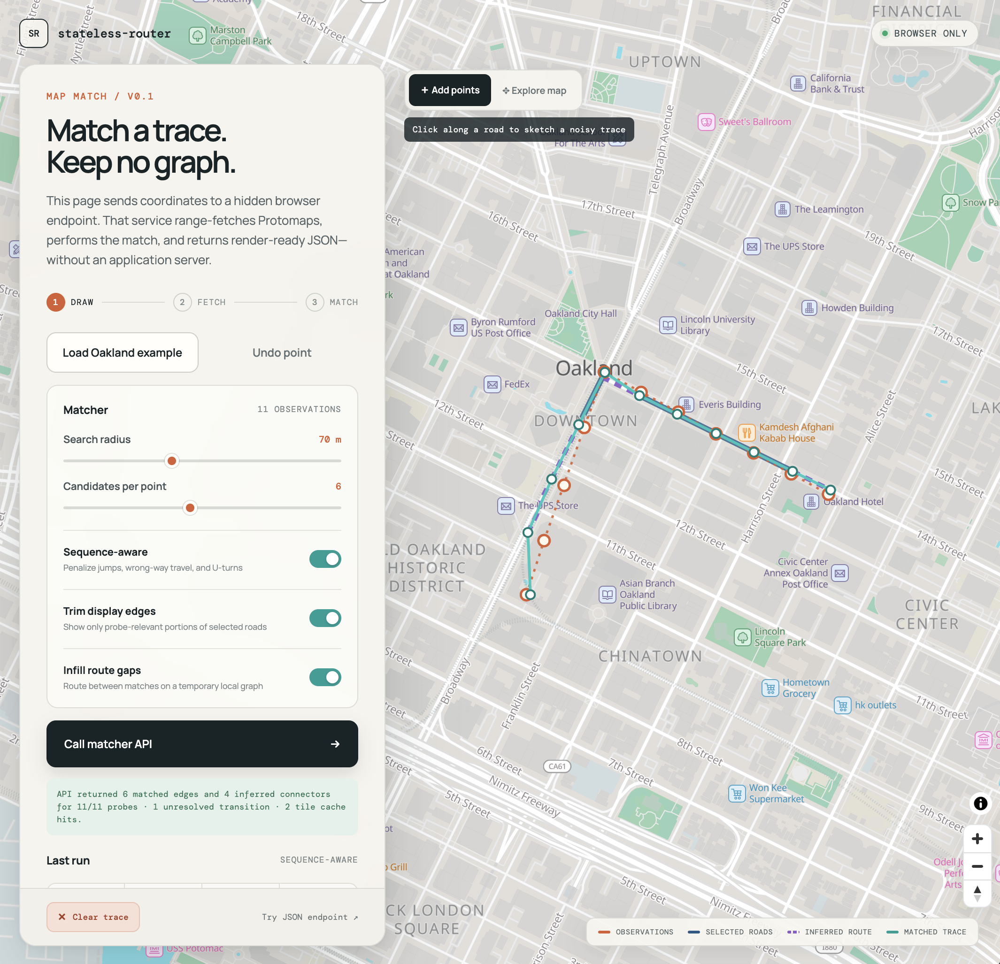
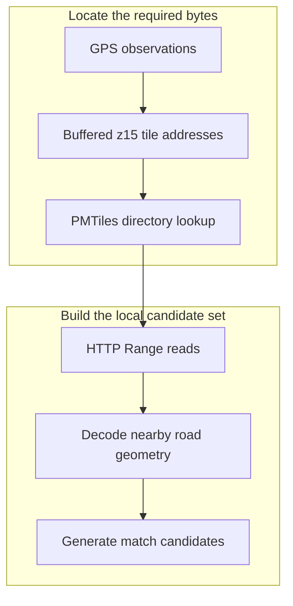
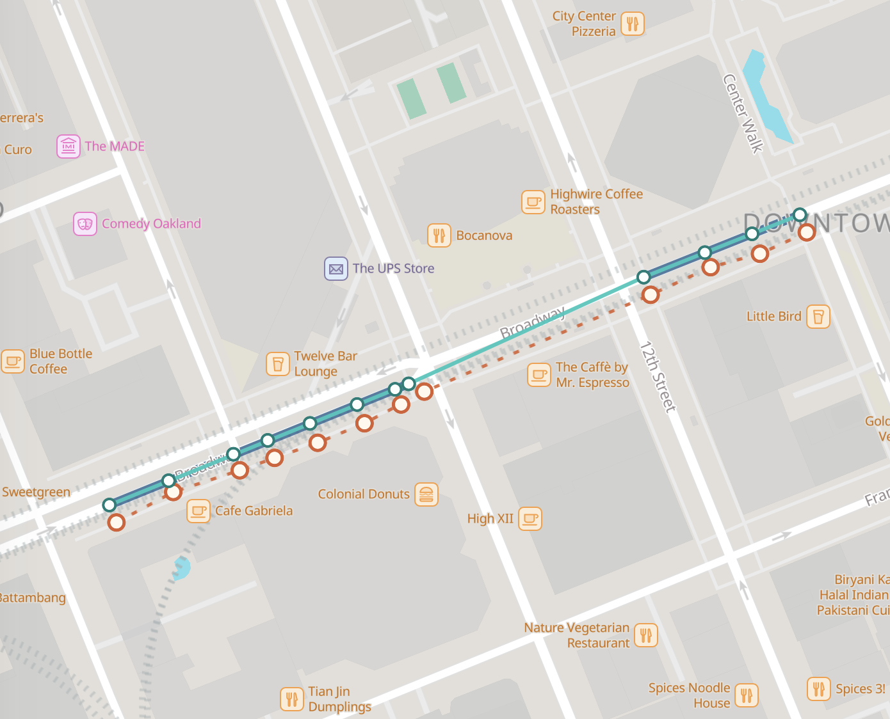
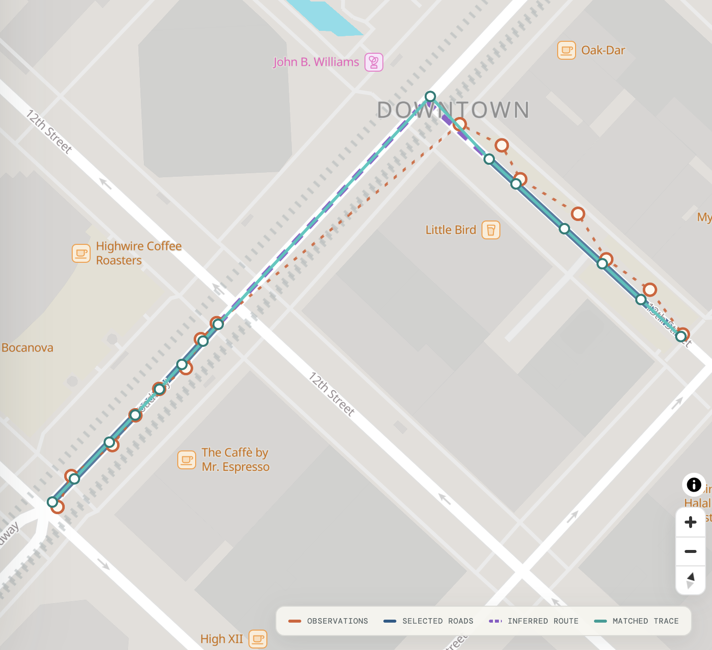
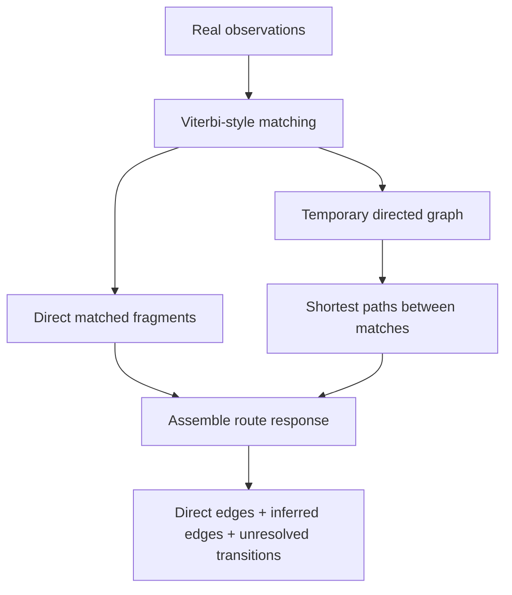

*HTTP range requests, a temporary road graph, and browser-native RPC*

A map matcher normally begins with a road graph. Before the first GPS observation can snap to a street, someone has to download the source data, normalize intersections, assign durable edge identifiers, build spatial indexes, and deploy a service that keeps the graph available. The matching request may be small, but the system behind it usually is not.

Projects such as [OSRM](https://project-osrm.org/) and [Valhalla](https://valhalla.github.io/valhalla/) show the moving pieces involved. Both projects make local and embedded use possible. OSRM includes a [Node.js API](https://github.com/Project-OSRM/osrm-backend/blob/master/docs/nodejs/api.md), for example, and Valhalla offers local bindings and packaged deployment options. A user still has to download OpenStreetMap data, transform it into optimized routing data, version the resulting graph, and keep it available to the application. The data management side often carries much of the operational weight.

For this post, I want to see how much of that machinery I can avoid.

The result is a [browser-only map-matching experiment](https://kuanbutts.com/stateless-router/map-match-v1/) that runs as a static site on GitHub Pages. It takes a sequence of longitude-latitude observations, fetches nearby road geometry from a remote Protomaps archive, selects a locally consistent sequence of road matches, and returns render-ready JSON. This service has no application server and no persistent global routing graph.

The project does build a graph. It builds a small, temporary one from the geometry around each request and discards it with the page. "Stateless" means that the service keeps no authoritative world graph between requests. Each request has working state while the calculation runs, and that is it.



*The complete experiment runs in the browser. The static page fetches Protomaps road tiles, performs sequence-aware matching, and returns JSON.*

## PMTiles as an on-demand geometry store

[PMTiles](https://docs.protomaps.com/pmtiles/) is a single-file archive format for tiled data. A reader asks for a tile using its `z/x/y` address, consults the archive directory, and uses HTTP Range requests to retrieve only the relevant bytes from the remote file. The archive can live in object storage or behind an ordinary static host that supports byte serving.

Protomaps publishes a basemap in this format. Its vector tiles include a [`roads` layer](https://docs.protomaps.com/basemaps/layers) derived from OpenStreetMap, with line geometry and useful attributes such as road class, name, reference, `oneway`, and structure or layer information. These features are intended primarily for cartography, but they contain enough local geometry to make a map-matching experiment possible.

The pipeline for creating and hosting a network of your own is also straightforward and inexpensive. I cover that setup in an earlier post about [building and serving Protomaps from GitHub Pages](https://kuanbutts.com/2023/06/13/protomaps-simple-gh-page-service/).

For each trace, the prototype converts the observations and search radius into a set of z15 tile addresses. The PMTiles reader resolves those addresses to byte ranges, the browser decodes the selected vector tiles, and the matcher filters the resulting road lines to plausible drivable candidates.

The browser does not download a planet-sized road graph. It limits the working set to local geometry around the trace.



This changes the operational shape of the problem. The basemap still requires preprocessing and hosting. PMTiles is a processed archive, not raw OpenStreetMap data. The map-matching application, however, does not need to build, deploy, or hold its own global graph. It assembles the local geometry it needs on demand for each match request.

## A sequence-aware matcher

For every observation, the matcher projects the point onto nearby road segments and keeps a small number of candidates. The default demo searches within 70 meters, which is tunable, and retains up to six candidates per observation.

A candidate scores better when it is close to the observation and when the direction of its road geometry is compatible with the apparent direction of travel. Choosing the nearest road independently for every point is not enough. Parallel streets, divided roads, frontage roads, and noisy observations can all produce locally plausible but globally strange results.

The matcher uses a Viterbi-style dynamic program to choose a consistent sequence. Its transition cost penalizes implausible changes in distance, unnecessary road changes, wrong-way movement on one-way features, and U-turns. This handles an early failure mode in which the first observation lands on the opposite carriageway from the rest of the trace and produces an unlikely U-turn at the beginning of the result.

I describe the matcher as "HMM-shaped" rather than as a calibrated hidden Markov model. The structure is familiar: candidate states, per-observation costs, transition costs, and dynamic programming. The current emission and transition values are hand-tuned scores rather than learned or statistically calibrated probabilities. I discuss HMM map matching in more detail in my post about a [lightweight Go router](https://kuanbutts.com/2025/12/25/lightweight-go-router/).

That approach is sufficient for the question I want to test with this project: can a browser obtain the right local geometry on demand and choose a useful sequence of road matches without a massive preprocessed world graph?

## Cartographic features are not routing edges

The first visual problem is overshoot on edge matches. A probe can match a road near an intersection while the selected Protomaps feature continues well past the turn. Vector tiles are processed for cartography, so a feature is not necessarily a clean routing edge that runs from one intersection to the next. Rendering the complete source feature can make it look as if the matched route continues through the intersection before doubling back.

This is not necessarily a matching error. It is a mismatch between the unit returned by the vector tile and the portion of that geometry supported by the observations.

The response preserves both forms:

- `sourceGeometry` contains the original Protomaps line used by the matcher.
- `geometry` contains a probe-relevant fragment trimmed around the matched positions.

The trimming is deliberately conservative. It does not claim that the endpoints are verified intersections. The response labels them as synthetic fragment endpoints and sets `intersectionInferred: false`. They make the result easier to render and consume without pretending that a cartographic vector tile supplies authoritative routing topology.

This is also why z15 should not be treated as a universal accuracy guarantee. It is the tile-request level used by this experiment, not a promise that every intersection, lane, or legal maneuver is encoded as a routable node. In downtown Oakland, the geometry is detailed enough for this prototype to produce useful matches. That is an empirical result, not a general contract.

## Direct matches can still leave holes

Trimming fixes overshoot, but it exposes a new problem. If the observations directly support fragments on either side of an intersection, or disappear for a block, the set of matched fragments can look like a checkered line. Matched edges continue and then suddenly disappear. We know that a trajectory continues between two matched positions, but no observation directly selects the intervening portion.

Drawing a straight line between those positions hides the gap, but it can cut a corner, cross a building, or imply travel on a road the vehicle never uses. Adding synthetic observations every ten meters has the same weakness. The interpolated chord becomes evidence even though the algorithm invents it.

This version separates direct matching from route inference.

<figure class="post-image-comparison">
  <div class="post-image-comparison__grid">
    <div>
      <p class="post-image-comparison__label">Directly supported matches</p>
      
    </div>
    <div>
      <p class="post-image-comparison__label">Inferred route connector</p>
      
    </div>
  </div>
  <figcaption>Direct matches may not cover every part of a continuous trajectory. The dashed purple geometry is inferred by routing through the temporary local graph and is returned separately from observation-supported matches.</figcaption>
</figure>

After matching the real observations, the browser constructs a directed graph from the road geometry it already has. It splits line segments at snapped probe positions and at compatible geometric crossings, then adds directed arcs according to the available one-way tags. Explicitly incompatible layer or structure information prevents some false connections at grade-separated crossings.

The browser then runs a bounded shortest-path search between each pair of consecutive matched observations. Travel along the same source road uses the direct slice of that road. Other transitions use the local directed graph. The matcher rejects paths that are implausibly long relative to the observation spacing.

Only the uncovered portions of successful paths become `inferredEdges`. They appear as dashed purple lines and carry explicit metadata:

```json
{
  "id": "inferred:001",
  "fromProbe": 3,
  "toProbe": 4,
  "provenance": "inferred_transition",
  "confidence": "geometry_only",
  "sourceRoadIds": ["..."],
  "startNode": "node:...",
  "endNode": "node:...",
  "geometry": {
    "type": "LineString",
    "coordinates": ["..."]
  }
}
```

The color and the contract preserve an important difference. A teal fragment is supported by a direct match. A purple fragment is required to connect matches through the temporary geometry graph.

If the browser cannot find a plausible path, it leaves the transition unresolved. The included Oakland example currently reports four inferred connectors and one unresolved transition. I prefer that visible failure to a silently drawn straight line. The unresolved transition shows where a cartographic working set stops short of a routing database.



## A service boundary without an application server

The visual map and the matcher are separate even though both run in the browser. The map loads `/map-match-api-v1/` in a hidden iframe and sends it versioned messages with `window.postMessage`. The endpoint page owns the PMTiles reads, decoding, candidate matching, local cache, route inference, and response serialization. The visible map renders only the returned GeoJSON.

The request payload is intentionally small:

```json
{
  "coordinates": [
    [-122.2727, 37.8009],
    [-122.2712, 37.8044]
  ],
  "options": {
    "radiusMeters": 70,
    "candidateCount": 6,
    "sequenceAware": true,
    "edgePaddingMeters": 0,
    "inferRoute": true
  }
}
```

The parent page wraps this object in a message with a protocol type and request ID:

```js
iframe.contentWindow.postMessage(
  {
    type: "stateless-router:match:v1",
    id: "request-1",
    request: { coordinates, options }
  },
  new URL(iframe.src).origin
);
```

The endpoint emits progress messages and eventually returns either `stateless-router:response:v1` or `stateless-router:error:v1` with the same request ID. This gives the frontend a service-like boundary without requiring a deployable backend.

The response contains:

- The input and snapped position for every probe, including match error.
- Direct-match edges with geometry ordered in the selected travel direction.
- Original source geometry for debugging.
- Synthetic start and end nodes for each returned fragment.
- Separately identified geometry-only inferred edges.
- Ordered edge sequences and per-probe-pair transition results.
- GeoJSON collections ready for rendering.
- Tile, cache, error, and elapsed-time statistics.

This is page-backed RPC, not an HTTP JSON endpoint. GitHub Pages cannot accept an application `POST`, and requesting the URL with `curl` downloads the HTML and JavaScript rather than executing a match. A caller loads the endpoint in a browser context and communicates with it through the message contract.

The separation is still useful. The protocol is independent of the visible map, so another browser frontend can reuse the matcher without importing its UI. The computation can later move from the endpoint page into a Web Worker without changing the public message shapes.

## Trying it

The [interactive map matcher](https://kuanbutts.com/stateless-router/map-match-v1/) lets you click a trace onto the map, load the included Oakland example, adjust matcher settings, and inspect the direct and inferred route geometry.

The lighter [JSON runner](https://kuanbutts.com/stateless-router/run-map-match/) accepts a coordinate array and shows the complete response. It also supports a URL-encoded `coordinates` query parameter, which makes a short browser-executed request shareable as a link.

The full matcher is embedded below on larger screens. On a narrow screen, open the standalone demo so the map and controls have enough room.

<div class="post-interactive-embed">
  <iframe
    src="https://kuanbutts.com/stateless-router/map-match-v1/"
    title="Browser-only Protomaps map matcher"
    loading="lazy"
  ></iframe>
</div>

<p class="post-interactive-fallback"><a href="https://kuanbutts.com/stateless-router/map-match-v1/">Open the interactive map matcher</a></p>

The source for the experiment is available in the [`stateless-router` repository](https://github.com/kuanb/stateless-router).

## IDs, direction, and what the response does not promise

The response has identifiers because a consumer needs to refer to nodes and edges within a result. Those identifiers should not be confused with durable road references.

Direct edges currently receive request-local IDs such as `edge:001`. A `sourceRoadId` combines tile and vector-feature information, so it is useful for debugging within the current Protomaps dataset but is not guaranteed to survive a new archive build. Synthetic node IDs are made from coordinates rounded to seven decimal places. Inferred edges receive request-local sequential IDs.

None of these identifiers is OpenLR. They are not currently intended to join the match result to another routing, traffic, or asset-management system.

Direction has a similar boundary. The matcher reads available `oneway` attributes and orders returned geometry in the selected direction of travel. Bidirectional features can be traversed in either direction. This prevents many obvious wrong-way paths, but it does not reproduce the legal model of a production router. There are no turn restrictions, conditional access rules, lane movements, or complete intersection semantics.

For that reason, the response reports `route.connectivityInferred` separately and always leaves `route.connectivityVerified` as `false`.

## Sparse data and other failure modes

The prototype works best when observations are frequent enough for their search areas to cover the roads that connect them. Sparse observations create two related risks.

First, the correct connecting road can lie in a tile that is never fetched. The current implementation selects tiles around the real observations, not around every possible corridor between them. Interpolated positions can help select additional tiles without becoming fake observations, but a robust implementation needs a principled corridor-fetch strategy and hard request limits.

Second, a longer gap admits more plausible routes. The local graph can find a geometrically valid path that is not the path actually traveled. A production matcher normally addresses this with a richer routable graph, better-calibrated transition probabilities, speed and timing information, road-class priors, and sometimes additional sensor data.

Geometry-derived topology introduces its own ambiguity. Two lines that cross on a map are not necessarily connected on the ground. Layer and structure tags help, but missing or simplified attributes can still create false intersections. Tile boundaries and generalized features can also make connected roads appear separate.

Finally, this page is a public experiment, not an operated API. It has no authentication, rate limits, uptime contract, or server-side control over resource use. The default public PMTiles source is appropriate for low-volume exploration. A serious deployment still needs to host and version its own archive, but that is easier than managing a stateful matching engine. Capacity is primarily bounded by static-data read rates rather than application-server compute, which is also more accommodating of bursty utilization.

## Thinking ahead to what comes next

The post-match router is intentionally a second phase. A more complete matcher uses network distance during the Viterbi transition itself. Instead of first choosing candidate roads and then asking how to connect them, each candidate-to-candidate transition considers the shortest legal path through the local graph. Route continuity then influences the match rather than merely repairing its output.

I also want to separate tile acquisition from observation generation. For a large gap, intermediate points can identify PMTiles cells worth fetching, but the matcher should not score those generated points as if they came from the GPS device.

The larger opportunity is a purpose-built PMTiles archive for routing rather than cartography. Such an archive could provide:

- Edges normalized at authoritative intersection nodes.
- Durable source identifiers across tile boundaries.
- Complete direction and access attributes.
- Turn restrictions and grade-separated connectivity.
- Optional OpenLR references or another interoperable location scheme.

The browser can retain the same range-request pattern while operating on data designed for routing. A result can then identify plausible geometry and the durable network edges used by other internal systems.

## Current limitations

This experiment shows that the graph used for matching does not always need to be global, resident, or served by an application backend.

For relatively short traces, rather than routes that extend for many miles, PMTiles can act as an on-demand geometry store. The browser retrieves a small spatial working set, runs a sequence-aware matcher, constructs a temporary local graph, and clearly distinguishes direct evidence from inferred connectivity. It exposes that computation behind a reusable RPC contract while remaining a collection of static files.

The unresolved issues around edge ID transmission, pure-geometry matching, and the lack of an authoritative graph are reminders of the limits of using cartographic geometry as a stand-in for a routable network. A production system may need source data that encodes authoritative topology, stable identity, and clearly marked allowed maneuvers. This project still demonstrates the viability of range-based lookup and the serverless potential it unlocks.
