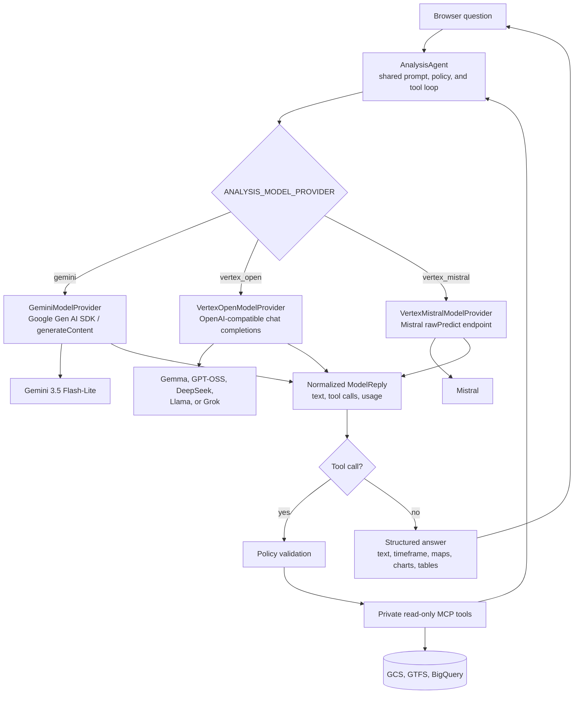

I have a simple analysis chatbot on my [AC Transit performance site](https://ac-transit.com/), and it uses Gemini. This post covers the exercise of determining whether I could replace it with a less expensive, open-weight model without making the product worse.

I have experimented enough with different language models to know that published benchmark metrics generally do not map cleanly to domain-specific tasks. The chatbot here does a pretty specific job: a visitor asks about AC Transit performance; the model selects from a small set of read-only data tools, as described in my post on [prototyping agent chat interfaces with FastMCP](/2026/11/06/rapid-agent-chat-interface-prototyping-with-fastmcp/); and the interface returns a short answer, timeframe, and sometimes a map, chart, or table. It is a good setting for a small, practical evaluation because the question paths and breadth of accepted response behavior are fairly constrained.

## Evals overview

An evaluation, or eval, is a repeatable test of whether a model does the work an application expects. This is not an attempt to measure general intelligence or declare one model universally better than another. Instead, it is scoped to the pattern check of, given this prompt, this tool catalog, this policy, and this synthetic tool result, does the model take the expected path and produce the required evidence? It runs this through a series of "stories" to make sure the flows go as expected.

The cases were hand-curated from three sources:

1. Representative questions from developing and using the chatbot, such as “How is Route 1T performing?” and “Which hours tend to have the most dropped trips?”
2. Self-defined product boundaries, including route-page scope, separate route service groups, off-topic questions, and prompt-injection attempts.
3. Real failures promoted into regression cases. One example came from asking which routes had the most dropped trips and which had improved or worsened over four weeks. In this case, I had personally noticed that an early Gemma deployment refused to do the comparison even though the available tools could support it.

Gemini provided a decent behavioral baseline for the conversational flows used to build a reference dataset. From this, I extracted patterns rather than using the results verbatim. The reference set includes things such as the required tool, important arguments, resolved dates, facts that must appear, facts that must not appear, and required visual artifacts. I still manually curate whether each contract represents the product we want. So Gemini remains a competitor in the test, not an infallible model everything else is compared to.

Here is a shortened version of the four-week trend case:

```json
{
  "prompt": "Over the past 4 weeks, which regular routes had the most dropped trips, which got worse, and which got better?",
  "expected_calls": [
    {
      "name": "rank_route_trends",
      "arguments": {
        "metric": "dropped_trips",
        "period": "week",
        "order": "worsened",
        "route_group": "regular"
      }
    },
    {
      "name": "rank_route_trends",
      "arguments": {
        "metric": "dropped_trips",
        "period": "week",
        "order": "improved",
        "route_group": "regular"
      }
    }
  ],
  "expected_timeframe": {
    "start_date": "2026-10-12",
    "end_date": "2026-11-08"
  },
  "required_artifacts": {
    "chart_count": 3,
    "tables": 3
  },
  "answer_contains_all": ["1T", "180", "210", "45", "6", "50"],
  "answer_forbidden": ["cannot", "can't", "impossible"],
  "max_calls": 2
}
```

The fixture says, among other things, that Route 1T has the highest four-week total at 180 dropped trips, Route 210 worsens from 20 to 45, and Route 6 improves from 50 to 20. Those are intentionally synthetic values, not claims about actual AC Transit service. Distinct numbers make it possible to check whether the final prose is grounded in the tool results rather than merely plausible-sounding.

Each turn gets diagnostic scores for:

- exact tool selection and ordering;
- required tool arguments and resolved timeframe;
- answer policy, expressed as required and forbidden terms;
- required maps, chart types, chart counts, and tables; and
- efficiency, including the call limit and whether every tool call succeeded.

The weighted diagnostic score is 40% tool selection, 25% arguments, 20% answer policy, 10% artifacts, and 5% efficiency. For overall pass score, every dimension must pass. This provides both a binary regression signal and enough detail to see why a model failed. No second language model needs to act as a subjective judge in this harness.

Multi-turn cases preserve the prior questions and answers just as the application does. For example:

```text
User: How is Route 1T performing?
User: What about last month?
User: And how many trips were dropped by day and hour?
```

The second turn must retain Route 1T while resolving “last month” to exact dates. The third must re-query the correct service-profile tool with the same route and dates, then retain both the daily bar chart and hourly heatmap. Each turn is scored independently, so a good first answer cannot hide a broken follow-up.

The harness uses the production agent loop and model adapters but swaps production data access for a deterministic fixture gateway. Tool descriptions and JSON schemas are derived directly from the MCP server source, so changing the interface becomes part of the next evaluation. A manually triggered [GitHub Actions workflow](https://github.com/kuanb/actransit_perf_v2/blob/main/.github/workflows/model-eval.yml) runs the paid comparison when needed, writes detailed JSONL plus summary CSV/JSON, and can fail against configurable overall and critical thresholds. It does not run on every commit.

## General passes versus critical passes

The **general pass rate** is the strict pass rate across every evaluated turn. The **critical pass rate** applies the same all-or-nothing test, but only to the subset that has been set as must-not-break behavior: system and route overviews, relative-date resolution, dropped-trip analysis, route-group boundaries, prompt-injection and off-topic refusals, route-page scope, required caveats, and follow-up context.

Critical is not necessarily harder and does not mean a higher weighted score: a formatting miss on a secondary query and a scope leak should not have equal influence on a deployment decision. But it does provide an explicit check on required behavior.

## Results from comparison runs

I ran a suite of 16 scenarios and 18 total turns on November 20, 2026. “Cost per turn” includes all model calls needed for that user turn, including the tool-selection and post-tool answer rounds. Partner-model prices are pulled from published rates as of November 19.

| Model | Broad pass | Critical pass | p95 latency | Input / output / cache-hit price per 1M tokens | Observed cost per completed turn | Cost vs. Gemini |
|---|---:|---:|---:|---:|---:|---:|
| Gemini 3.5 Flash-Lite | 77.8% | 76.9% | 3.00s | $0.30 / $2.50 / $0.03 | $0.001463 | baseline |
| Gemma 4 26B | **94.4%** | **92.3%** | 11.88s | $0.15 / $0.60 / $0.015 | $0.000667 | **54.4% less** |
| GPT-OSS 120B | 38.9% | 38.5% | 3.78s | $0.09 / $0.36 / $0.09 | $0.000467 | 68.1% less |
| DeepSeek V4.1 Flash | 61.1% | 61.5% | 17.63s | $0.30 / $1.20 / $0.03 | $0.001569 | 7.2% more |
| Mistral Small 3.1 | 61.1% | 61.5% | 2.85s | $0.10 / $0.30 / $0.10 | $0.000453 | 69.0% less |
| Grok 4.7 | 83.3% | **92.3%** | 26.99s | $2.00 / $6.00 / $0.50 | $0.004695 | 220.9% more |


*Gemma sits on the quality-and-cost frontier for this evaluation. Grok passed the hardest trend case consistently, but at substantially higher cost and latency.*

Overall, Gemma was the best value: it had the highest pass rate and cost about 54% less per evaluated turn than Gemini. GPT-OSS and Mistral were cheaper, but their strict pass rates were too low. Grok performed well but was much slower and more costly.

I repeated the hardest trend case three times to expose nondeterminism:

| Model | Strict passes | Estimated cost per turn |
|---|---:|---:|
| Gemini 3.5 Flash-Lite | 0/3 | $0.001903 |
| Gemma 4 26B | 1/3 | $0.001196 |
| GPT-OSS 120B | 0/3 | $0.000492 |
| DeepSeek V4.1 Flash | 1/3 | $0.002609 |
| Mistral Small 3.1 | 0/3 | $0.000724 |
| Grok 4.7 | **3/3** | $0.010195 |

Only Grok reliably made both trend calls, preserved all three charts and tables, used the exact 28-day range, and grounded the narrative in the supplied values. Gemma was still reasonable as a default, but this also highlights why observed failures should be registered in tests so these cases get promoted from mere anecdotes to permanent regression checks.

## Where savings come from

Across the 18-turn broad run, Gemini’s corrected estimated total was $0.02634: $0.02161 for input and $0.00473 for output. Gemma’s total was $0.01200: $0.01073 for ordinary input, $0.00019 for cache-hit input, and $0.00107 for output.

The net savings were $0.01434, or 54.4%. About $0.01068 came from input and cache pricing, and $0.00366 came from output pricing. The providers reported 12,894 cached Gemma input tokens and no cached Gemini tokens in this run. The harness charges reported cache hits at each model’s cache-hit rate.

That cache result is not guaranteed: the application does not create a long-lived prompt cache. So to fully evaluate the price comparison, we should remove any cache benefit. Doing so results in the savings dropping from 54.4% to about 47.8%. Gemma still wins, regardless. All the models considered here are managed, serverless Model Garden APIs, so we just pay for token spend—there is no idling of GPUs in our case.

## Managing the different provider protocols

Vertex AI is Google Cloud’s unified machine learning and generative AI platform for building, training, tuning, evaluating, and deploying models and AI agents. Unfortunately, it does not expose every managed model through exactly the same request and response shape. For example, the current Gemini adapter uses Google’s native Gen AI SDK and `generateContent`. Meanwhile, most of the managed open models use Vertex’s OpenAI-compatible chat-completions endpoint. Mistral uses a publisher-specific `rawPredict` endpoint. What a mess.

The differences include tool-schema encoding, how tool results are appended to a conversation, and where token and cache usage appear in the response.



The application hides those differences behind a small internal `ModelProvider` / `ModelSession` protocol. Each adapter returns the same normalized reply containing text, tool calls, provider state, and token usage. The production selection is therefore two environment values—provider and model—while the policy, MCP tools, UI, and evaluation logic remain unchanged.

## Testing harness for long-term confidence

Gemma won the broad comparison, but the more important output here over the long term is our scoring mechanism for making model selections in the future. I can rerun the same cases after changing a prompt, tool description, MCP schema, response format, or model. This will help ensure stability as I tweak this tool and its functionality in the future.

This evaluation is intentionally small and application-specific. It is also now part of the application’s maintenance loop: collect representative questions, turn failures into deterministic cases, compare quality, latency, and cost, and keep the deployment choice easy to reverse.

---

**Pricing note:** Partner-model prices were pinned in the harness on November 19, 2026. Gemini figures in this post use the Standard on-demand tier after correcting a harness constant that used the Flex/Batch rate. See Google Cloud’s [Gemini pricing](https://cloud.google.com/model-garden/pricing) and [partner-model pricing](https://cloud.google.com/model-garden/partner-models/pricing) for current rates. The result files and scorer live in the [open-source project](https://github.com/kuanb/actransit_perf_v2/tree/main/services/agent/evals).
